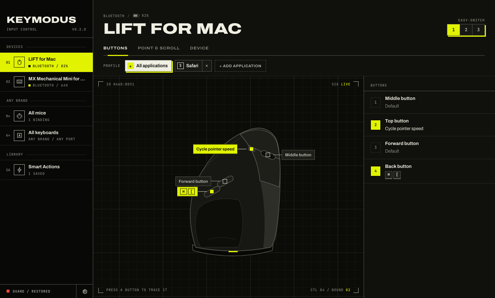
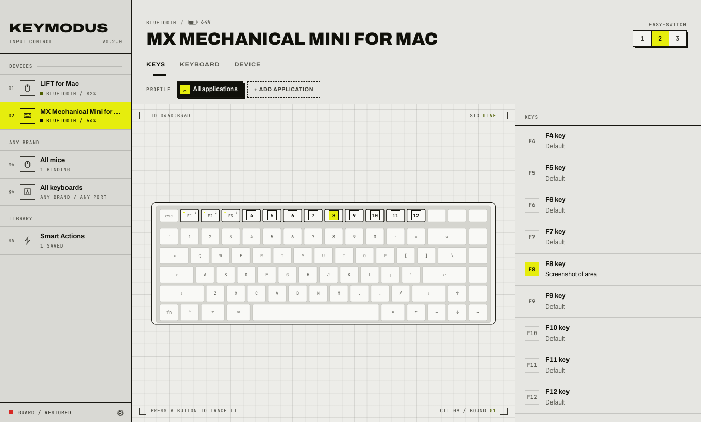
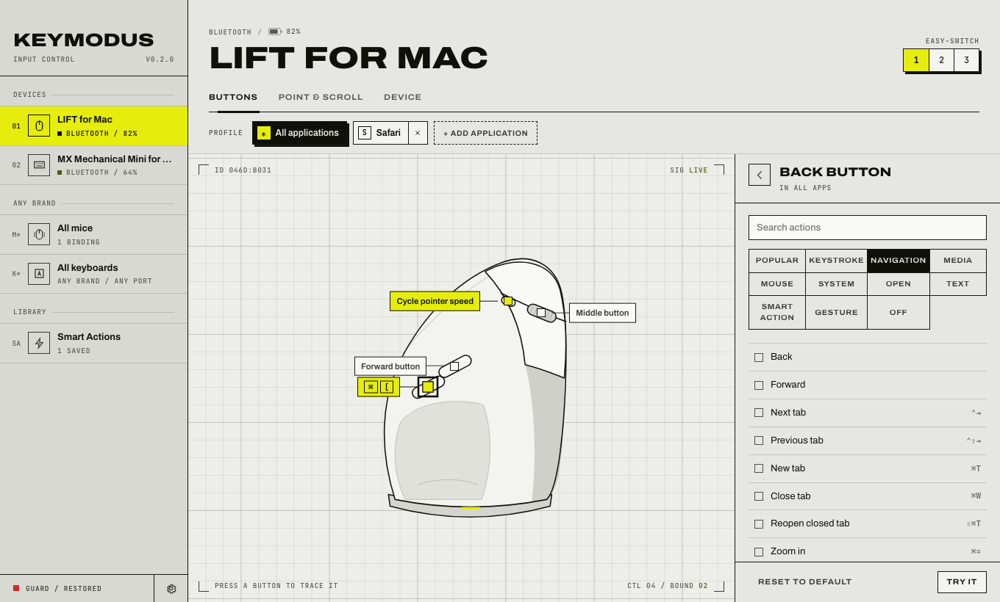
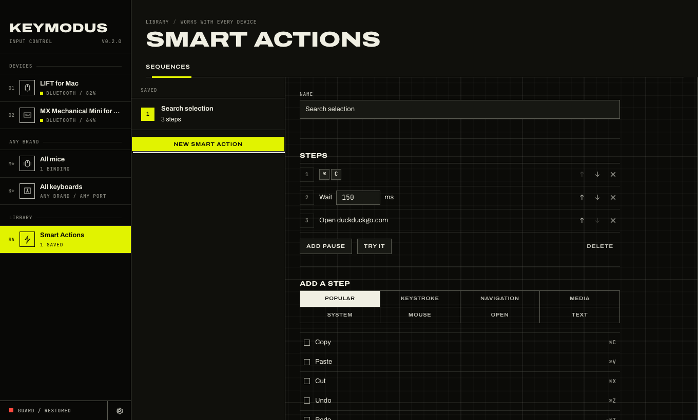
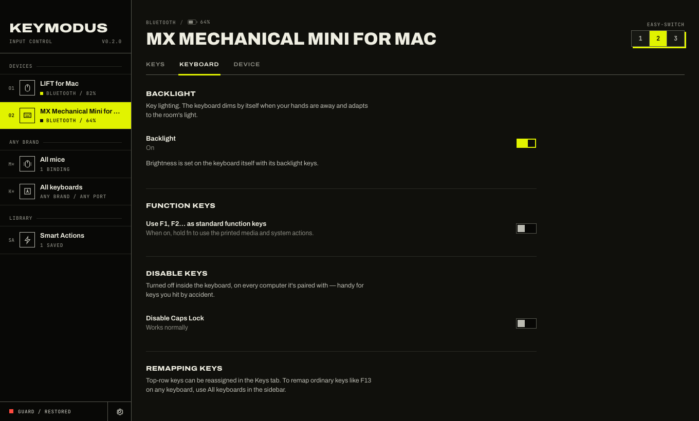

# Keymodus

**An open-source alternative to Logi Options+ for Logitech mice and keyboards, written in Rust.**
Remap buttons and keys per app, build multi-step Smart Actions, set pointer
speed, backlight, Fn keys and Easy-Switch channels — on macOS, Windows and Linux.
It's about 10 MB, has no account and no telemetry, and keeps your bindings
working when the device sleeps or reconnects.



> Keymodus is an independent project. It is not affiliated with, endorsed by or
> supported by Logitech. Logitech, Logi Options+, LIFT and MX are trademarks of
> Logitech. Keymodus ships no Logitech software, firmware or artwork.

## Features

| | |
|---|---|
| **Buttons & keys** | Assign any button or top-row key: keystrokes (held while you hold the button), media keys, mouse buttons, system actions, open an app or link, run a command, type text, cycle DPI, or turn it off. Searchable action picker with Popular and Navigation presets. |
| **Per-app profiles** | Give an app its own assignments. Anything you don't override follows *All applications*. |
| **Smart Actions** | Chain steps: press a shortcut, pause, open a link, type text… then put the whole sequence on one button. |
| **Gestures** | Hold a gesture-capable button and move the mouse: up, down, left, right or a plain press, each with its own action. |
| **Point & scroll** | DPI slider and presets for *Cycle pointer speed*. Hi-res scrolling, wheel direction and SmartShift on wheels that support them. |
| **Keyboard** | Backlight on/off (and adaptive or fixed level where the firmware offers it), standard F-keys vs media keys, disable Caps Lock and other keys in hardware. |
| **Easy-Switch** | See which channel a device is on and send it to another computer. |
| **Any brand** | *All mice* / *All keyboards* remap extra buttons and spare keys (F13–F20…) on non-Logitech devices too (macOS and Windows). |
| **Binding guard** | Logitech devices forget remapped buttons when they sleep or reconnect. Keymodus re-applies them on reconnect, reads them back every 15 s and restores anything that was dropped. *Activity* shows each restore. |
| **Safe settings** | Atomic writes, the last 30 versions kept as backups, a damaged file is set aside rather than overwritten. Export/import your setup as JSON. |
| **Updates** | Checks GitHub Releases at launch and every 6 hours, shows a banner, and installs only when you click. Every download is verified against the project's signing key. |
| **Options+ import** | On macOS, copies your button assignments and app profiles from Logi Options+ (read-only). |

<p>




</p>

### Devices

Keymodus talks HID++ 2.0, the protocol used by current Logitech mice and
keyboards over Bluetooth, Bolt and Unifying receivers. It discovers what each
device supports at runtime, so most MX, Ergo and LIFT devices work.

Tested on hardware: **LIFT for Mac** (046D:B031) and **MX Mechanical Mini for
Mac** (046D:B36D), both over Bluetooth on macOS. They also have dedicated
illustrations. Other devices get a schematic drawing. Please [report how
yours works](https://github.com/aflorea4/keymodus/issues/new?template=device.yml).

## Install

Download the latest build from **[Releases](https://github.com/aflorea4/keymodus/releases/latest)**.
After that, Keymodus offers new versions itself.

### macOS (12 or later, Apple Silicon and Intel)

1. Open `Keymodus_<version>_universal.dmg` and drag Keymodus to Applications.
2. The build isn't notarized by Apple yet, so the first time, **right-click
   Keymodus → Open → Open**. You can also run
   `xattr -dr com.apple.quarantine /Applications/Keymodus.app`.
3. Allow **Accessibility** when the banner asks; that permission lets Keymodus
   send keystrokes and clicks. If your devices don't show up, also allow
   **Input Monitoring**. Both are in System Settings → Privacy & Security.

Releases are signed with a stable project certificate, so these permissions
stay granted across updates.

### Windows 10/11 (x64)

Run `Keymodus_<version>_x64-setup.exe` (installs per user, no admin) or the
`.msi`. SmartScreen may warn because the installer isn't signed by a
registered publisher. Choose **More info → Run anyway**.

### Linux (x64)

- **Debian/Ubuntu:** `sudo apt install ./Keymodus_<version>_amd64.deb`
- **Fedora/openSUSE:** `sudo dnf install ./Keymodus-<version>-1.x86_64.rpm`
- **Anything else:** `chmod +x Keymodus_<version>_amd64.AppImage` and run it.

The `.deb` and `.rpm` packages install a udev rule that lets your user talk to
Logitech HID devices and to `/dev/uinput`, which is how Keymodus sends keys.
With the AppImage, install the rule yourself and log out and back in:

```sh
sudo curl -fsSL -o /etc/udev/rules.d/70-keymodus.rules \
  https://raw.githubusercontent.com/aflorea4/keymodus/main/packaging/linux/70-keymodus.rules
sudo udevadm control --reload-rules && sudo udevadm trigger
```

Per-app profiles need X11; on Wayland the *All applications* profile applies
everywhere. *Type text* uses `xdotool` (X11) or `wtype` (Wayland) if installed.

### Platform support

| | macOS | Windows | Linux |
|---|:-:|:-:|:-:|
| Logitech buttons, keys, DPI, wheel, backlight, Easy-Switch | ✅ | ✅ | ✅ |
| Per-app profiles | ✅ | ✅ (by `.exe`) | ✅ X11 only |
| Any-brand mice/keyboards | ✅ | ✅ | — planned |
| Options+ import / pause | ✅ | — | — |
| Tested on real hardware | ✅ | build-tested only | build-tested only |

## Privacy

Keymodus needs no account and sends no telemetry. Its only network request
fetches `latest.json` from this repository's GitHub Releases to check for
updates, and you can turn that off in Settings. Keystrokes are never recorded.
The app only sees presses of buttons you've remapped, plus keys on *All
keyboards* that you've assigned.

## Why Options+ "forgets" buttons

Reverse engineering of Options+ (see [docs/reverse-engineering.md](docs/reverse-engineering.md))
shows how it goes wrong:

1. **Remapping is volatile.** Options+ remaps a button by *diverting* it with
   HID++ feature `0x1B04`. The device keeps that flag in RAM only, so sleep,
   Easy-Switch, a Bluetooth reconnect or a low battery clears it. Options+
   re-diverts on reconnect, but without retry or read-back. If that request
   lands mid-reconnect, the button silently returns to its factory function
   and you see a "device error".
2. **Settings live in one JSON blob** in one SQLite row, rewritten on every
   change, with no local history.

Keymodus re-applies diversions on every connection and on the device's
"reconfigure me" event (`0x1D4B`). It verifies them periodically and on the
first input after an idle period, and it never changes your configuration
because of a device event.

## Build from source

You need Rust (stable) and [tauri-cli](https://v2.tauri.app/) 2:
`cargo install tauri-cli --version '^2' --locked`.
On Linux you also need `libwebkit2gtk-4.1-dev libayatana-appindicator3-dev librsvg2-dev libudev-dev`.

```sh
cargo test --workspace                 # protocol, config, store, importer tests
cd app && cargo tauri dev              # run with live UI reload
cd app && cargo tauri build            # installers for this OS in target/release/bundle
scripts/bundle.sh --universal          # macOS: universal Keymodus.app
scripts/package.sh                     # macOS: branded .dmg + .pkg in dist/
cargo run -p keymodus --example probe  # list HID++ features/controls of connected devices
```

UI preview without the backend: `python3 -m http.server -d ui` and open
`http://localhost:8000`. `ui/mock.js` provides sample devices. Add `?os=windows`
or `?os=linux` to preview other platforms.

## How it fits together

```
crates/hidpp   HID++ 2.0 framing, request/response matching and features
               (0x0001 0x0003 0x0005 0x1000 0x1004 0x1814 0x1982 0x1B04 0x1D4B
                0x2110 0x2121 0x2201 0x40A3 0x4521). No I/O; unit-tested with a fake transport.
crates/core    Config model and migrations, crash-safe store, key maps for all three OSes,
               per-OS paths, Options+ importer and device catalog
app/src        engine.rs     HID supervisor, per-device workers, binding guard, gestures
               actions.rs    action execution and Smart Action sequences
               platform/     macos.rs / windows.rs / linux.rs: input synthesis, any-brand hook,
                             frontmost app, permissions, login item, app list
               updates.rs    the update agent (GitHub Releases + signature check)
               main.rs       Tauri commands, tray, menus
ui/            index.html, styles.css, app.js (vanilla JS, no build step), devices.js
               (original device drawings), mock.js
packaging/     Linux udev rule
scripts/       macOS bundling and installer artwork
```

Settings live in `~/Library/Application Support/Keymodus` (macOS),
`%APPDATA%\Keymodus` (Windows) or `~/.config/keymodus` (Linux). Logs go to
`~/Library/Logs/Keymodus`, `%LOCALAPPDATA%\Keymodus\logs` or
`~/.local/state/keymodus`.

## Releasing

Bump the version in `Cargo.toml` and `app/tauri.conf.json`, add a
`CHANGELOG.md` entry, then push a tag:

```sh
git tag v0.2.1 && git push origin v0.2.1
```

`.github/workflows/release.yml` builds macOS (universal), Windows and Linux
installers and attaches them to a GitHub Release with a signed `latest.json`.
Installed copies then offer the update. The workflow needs these repository
secrets:

- `TAURI_SIGNING_PRIVATE_KEY` and `TAURI_SIGNING_PRIVATE_KEY_PASSWORD`: the
  updater key (`cargo tauri signer generate`). The public half is in `tauri.conf.json`.
- `MACOS_CERTIFICATE` (base64 `.p12`) and `MACOS_CERTIFICATE_PASSWORD`: the
  code signing identity. A self-signed one is enough to keep macOS permissions
  stable across updates.

## Contributing

Issues and pull requests are welcome. See [CONTRIBUTING.md](CONTRIBUTING.md),
and [SECURITY.md](SECURITY.md) for reporting vulnerabilities.

## License

[MIT](LICENSE). Bundled fonts (Archivo, JetBrains Mono) are under the SIL Open
Font License; see `ui/fonts`.
